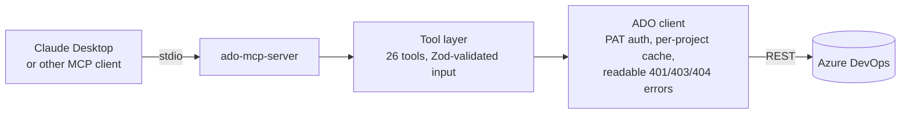

# ADO MCP Server

[](https://github.com/youssefmohamedymsh/ado-mcp-server/actions/workflows/test.yml)


An [MCP](https://modelcontextprotocol.io) server that connects Claude, and any other MCP-compatible assistant, to **Azure DevOps**. Ask in plain language and it reads user stories, writes linked test cases, logs bugs and manages work items for you.

> *"Create three test cases for story #1042, covering the happy path, invalid input and a timeout, and link them to the story."*

## Why I built this

Most of a QA engineer's week goes on admin rather than testing: reading stories, turning acceptance criteria into test cases, copying steps into Azure DevOps, and chasing links between stories, tests and bugs. I built this server so an AI assistant can do that work directly in Azure DevOps, while the tester stays in charge of what gets tested and why.

It's one part of an AI-assisted QA workflow. Claude reads a story, drafts the test cases, and creates them in Azure DevOps already linked and formatted, so the team reviews them instead of typing them out.

## What it can do

**26 tools** across three groups:

| Group | Tools |
|---|---|
| **Navigate** | `list_projects`, `set_project`, `get_sprints`, `get_area_paths`, `get_board_columns`, `get_team_members` |
| **Read** | `get_user_stories`, `get_work_item`, `get_child_work_items`, `search_work_items`, `get_work_item_comments`, `get_work_item_updates`, `get_bugs`, `get_test_cases_for_story`, `get_test_runs`, `get_sprint_coverage` |
| **Create & manage** | `create_test_case`, `create_bug`, `create_user_story`, `create_epic_or_feature`, `create_child_task`, `update_work_item`, `assign_work_item`, `bulk_assign_work_items`, `link_work_items`, `add_attachment` |

QA-specific behavior:
- **Test cases are created with real steps.** Steps and expected results are converted into the XML Azure DevOps uses for test steps, with escaping handled, so they show up properly in Test Plans.
- **Traceability is built in.** Test cases are linked to their story when they're created, and a bug can be linked to the test case that found it.
- **Sprint coverage.** `get_sprint_coverage` gives the percentage of stories in a sprint that have at least one test case, and lists the ones that don't.
- **Switch projects mid-conversation.** Pick a project once with `set_project` and every later call uses it.

## How it works



- **Transport:** stdio. The MCP host starts the server as a subprocess, so there's no port to open.
- **One pattern per tool:** each file in `src/tools/` exports a handler, a Zod input schema and a description. Tests check that every tool is exported and registered consistently.
- **Shared client:** all HTTP calls go through `src/lib/adoClient.ts`. It handles auth, picks the right project, and turns Azure DevOps errors into messages that say how to fix them.
- **WIQL helper:** `src/lib/wiql.ts` runs Azure DevOps' two-step query (find IDs, then fetch the items) behind one call.

The full walkthrough is in [docs/ARCHITECTURE.md](docs/ARCHITECTURE.md).

## Quick start

**Requirements:** Node 18 or later, an Azure DevOps organization, and a Personal Access Token with **Work Items (Read & Write)** and **Test Management (Read & Write)**.

```bash
git clone https://github.com/youssefmohamedymsh/ado-mcp-server.git
cd ado-mcp-server
npm install
npm run build
cp .env.example .env   # then fill in ADO_ORG, ADO_PAT and optionally ADO_PROJECT
```

Then add the server to Claude Desktop. [`config/claude_desktop_config.json`](config/claude_desktop_config.json) has a template; put the absolute path to `dist/server.js` in it:

- **macOS:** `~/Library/Application Support/Claude/claude_desktop_config.json`
- **Windows:** `%APPDATA%\Claude\claude_desktop_config.json`

Restart Claude Desktop and try:

> *"List the projects in my organization, then show me the active user stories in Sprint 3."*

Values in the Claude Desktop config take priority over the `.env` file.

## Example prompts

- *"What's the test coverage for Sprint 4?"*
- *"Show me every bug assigned to me that's still Active."*
- *"Log a bug for test case #1100: the login button does nothing on mobile Safari."*
- *"Mark #2031 as Resolved and add a comment that regression passed."*
- *"Create a child task under #1042 to review the acceptance criteria."*
- *"Link #999 as the parent of #1000, #1001 and #1002."*

## Development

```bash
npm run dev         # run with hot reload
npm run typecheck   # type-check without building
npm test            # unit tests (Vitest)
npm run build       # compile to dist/
node scripts/validateTools.mjs   # check every tool is exported and registered
```

CI runs typecheck → build → tool validation → tests on Node 18 and 20 for every push and pull request.

### Adding a tool

1. Create `src/tools/myTool.ts` exporting `myTool`, `myToolSchema` and `myToolDescription`.
2. Import it in `src/server.ts` and register it with `server.tool("my_tool", ...)`.
3. Run `npm test`. The export-validation test fails if any of the wiring is missing.

## Project structure

```
src/
  server.ts          entry point: registers all tools over stdio
  tools/             one file per tool (26)
  lib/
    adoClient.ts     auth, per-project client cache, error messages
    projectContext.ts  the project chosen with set_project
    wiql.ts          two-step WIQL query helper
    formatSteps.ts   test steps → Azure DevOps XML
    loadEnv.ts       loads .env relative to the project, not the working directory
  types.ts
tests/               Vitest unit and wiring tests
scripts/             tool validation and tool count
config/              Claude Desktop config template
docs/ARCHITECTURE.md full technical walkthrough
```

## Security

- `.env` is git-ignored. Never commit a real token.
- Give the PAT only the two scopes above, and set it to expire.
- The server only does what your PAT allows, and every write it makes appears in Azure DevOps history under your name.

## License

[MIT](LICENSE) © Youssef Mohamed
